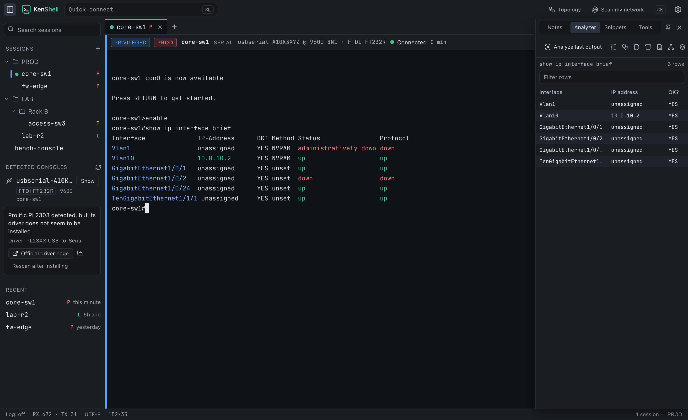
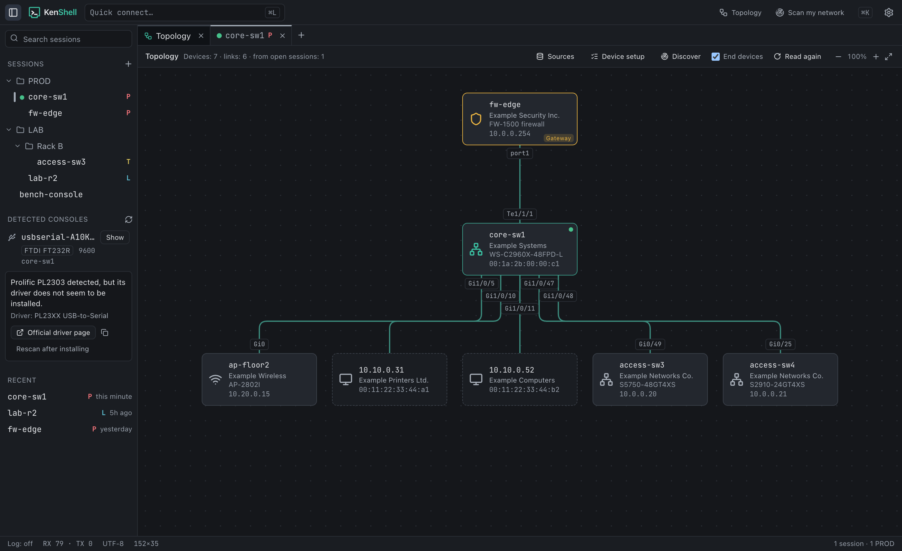
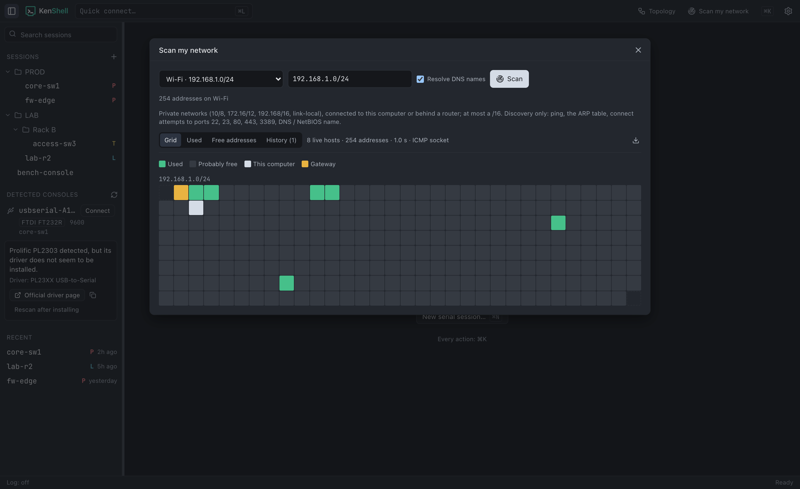
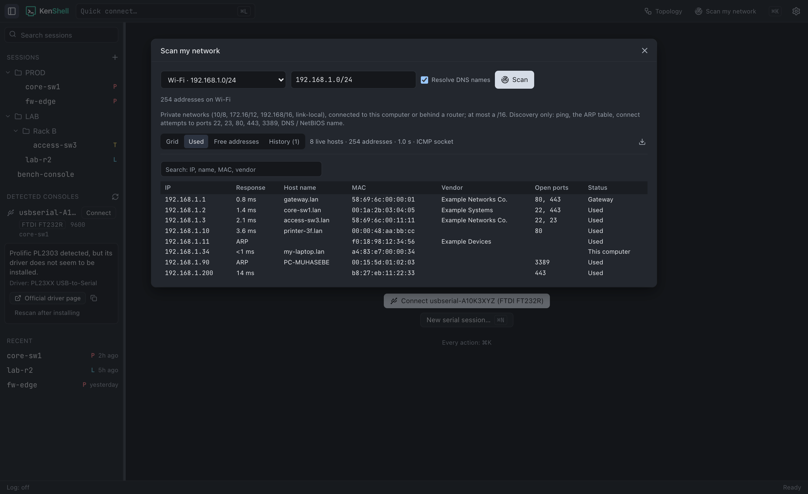

<p align="center">
  
</p>

<h1 align="center">KenShell</h1>

<p align="center">
  <b>The terminal that knows it is talking to a switch.</b><br/>
  SSH, Telnet and serial console in one small, fast desktop app,<br/>
  with a CLI analyzer, a topology map and a network scanner built in.
</p>

<p align="center">
  
  
  
</p>

<p align="center">
  <a href="#download-and-install"><b>Download</b></a> ·
  <a href="docs/USER_GUIDE.md"><b>User Guide</b></a> ·
  <a href="#a-quick-tour"><b>Tour</b></a> ·
  <a href="#features"><b>Features</b></a> ·
  <a href="#for-developers"><b>For developers</b></a>
</p>

<p align="center">
  
</p>

## Why I built KenShell

I'm a network engineer. On a normal day I'm on a dozen switches, routers, firewalls and
access points from several manufacturers, half of them over SSH and the other half through
a console cable in a cold server room. For years that meant PuTTY or SecureCRT for the
connection, a separate tool to make sense of the output, a spreadsheet for free IPs and a
whiteboard for the topology.

KenShell is the tool I wanted instead: one small, fast desktop app that knows it is talking
to network gear. Plug in a console cable and I'm on the device in seconds. Open an SSH
session and it tells me which device it is, which CLI mode I'm in and whether it's
production. Run a `show` command and I get a sortable table. Open the topology tab and it
draws how my switches are cabled together. Scan a VLAN and I see what is alive and which
addresses are free.

It runs on macOS, Windows and Linux. The interface is in English, with Turkish one click
away in **Settings → Language**.

## A quick tour

### Sessions that know where you are

Every session shows its connection identity (protocol, target, device name, model, OS
version) and a colour for the current CLI mode: user, privileged, config, boot or shell.
Production sessions carry a **PROD** tag so I never mistake them for lab gear. The analyzer
panel turns the last `show` output into a table I can filter, sort and export.

### Topology map

<p align="center">
  
</p>

The **Topology** tab draws my network as a hierarchy: the gateway on top, then the core,
then the access layer, each device as its own card with its type, model and IP, and the
port on both ends of every cable. It reads LLDP / CDP neighbours, MAC and ARP tables from
the sessions I have open, with hidden read-only commands. With SNMP (v2c or v3) it doesn't
even need a session: starting from one device it follows the neighbours until it has the
whole network. An sFlow / NetFlow collector adds the end devices. **Device setup** shows the
exact commands to enable LLDP, SNMP and flow export on each device type.

### Network scanner

<p align="center">
  
  &nbsp;
  
</p>

**Scan my network** finds what is alive on my own subnet or on a private network behind a
router, such as a switch management VLAN (up to a /16). It pings at a steady 2000 packets a
second, so a /24 takes a few seconds, and also knocks on the management ports (SSH, Telnet,
web, RDP) to catch devices that ignore ping. I get response times, MAC addresses, vendors,
DNS or NetBIOS names, a grid of used and free addresses, search, CSV export, and the last
20 scans saved. It is discovery only: no vulnerability scanning, no password guessing, and
only private address ranges.

### Plug-and-connect console

<p align="center">
  
</p>

Plug in a console cable and it appears in the sidebar with its chip and the last baud rate
that worked. KenShell detects the baud rate automatically and tells me when a driver is
missing, with a link to the official driver page.

## Features

**Connections**
- **Protocols:** SSH (password, public key, keyboard-interactive, agent, legacy algorithms
  per session), Telnet, serial, Rlogin and raw TCP.
- **SSH extras:** port forwarding (local, remote, dynamic/SOCKS5), jump host,
  SOCKS5/HTTP proxy, X11 forwarding, keepalive and auto-reconnect.
- **Host keys:** checked against known hosts. A changed host key blocks the connection.
- **Quick connect:** type `ssh admin@10.0.0.1`, `telnet 10.0.0.5 2001` or `COM4`.
- **Session manager:** nested folders, tags, favourites, instant search, recent connections,
  drag-and-drop and bulk edit.
- **Import and export:** import from PuTTY, SecureCRT, MobaXterm and CSV; export to JSON
  or CSV (never with passwords).
- **Credentials:** kept in the OS keychain, with reusable credential profiles, a portable
  encrypted vault backup (Argon2id + ChaCha20-Poly1305), and an SSH key generator
  (Ed25519/RSA, `.ppk` ↔ OpenSSH).

**Terminal**
- **Tabs:** draggable tabs, split view with up to four panes, and detaching a tab into its
  own window.
- **Everyday terminal features:** copy on select, paste with a right-click, regex search in
  scrollback, line timestamps, charsets and backspace mapping.
- **Smart paste:** a per-line delay for serial and Telnet, with an optional preview.
- **Broadcast:** type into several tabs at once; those tabs are clearly marked.
- **Output highlighting:** up/down states, errors, IP/MAC addresses and interface names are
  coloured. Clicking an IP or interface opens actions for it.
- **Automation:** command history with inline autocomplete, and automatic `--More--`
  continuation.
- **Logging and recording:** logging to disk (file-name templates, printable or raw, optional
  timestamps), session recording with a replay player, and export as TXT or coloured HTML.

**Analysis**
- **Structured output:** parsers turn `show` output into sortable tables you can export to
  CSV.
- **Read-only checks:** a diagnostics run with findings ranked by severity, and config audit
  rules.
- **Config backups:** compressed backups compared in a side-by-side diff.
- **Log analysis:** analyse `show tech`, crashinfo and log files.
- **Topology map:** a tab that draws every device your open sessions can see, as a
  hierarchy with the port on both ends of each link, manufacturer, model and IP. SNMP
  (v2c and v3) with automatic discovery follows the neighbours from one device to the
  whole network; an sFlow / NetFlow collector adds the end devices.
- **Multi-device:** run read-only commands on many devices at once.
- **Network scanner:** connected and routed private networks up to a /16; a paced ICMP
  sweep with response times (system ping as fallback), the ARP table, TCP
  22/23/80/443/3389, reverse DNS and NetBIOS names, vendor names from the built-in IEEE OUI
  table, search, CSV and the last 20 scans saved.

**Notes and snippets**
- **Device notes:** Markdown, pinnable, searchable, and linked to interfaces
  (`Gi1/0/24: camera`). They are shown as terminal tooltips and in the session list.
- **Notes bar:** opens under each session for quick, time-stamped notes, like a work log.
- **Snippets:** a library with starter sets for common CLIs, plus templates with variables
  and a fill-in form.

**Tools**
- **File transfer:** an SFTP/SCP client, and built-in TFTP, FTP and SCP servers for
  firmware and config transfers.
- **Network utilities:** subnet calculator, OUI lookup, MAC format converter, ping and
  traceroute.

**App**
- **Interface:** dark, light or system theme, English (default) and Turkish, customisable shortcuts,
  a command palette for every action, and accessible keyboard navigation.
- **Updates:** a small card announces a new version; nothing installs until you click it.
- **Privacy:** no telemetry. Passwords and secrets never reach logs, the database or exports.

## Performance

I wanted it to stay out of my way, even on an old laptop during a site visit, so speed and
size are hard limits checked on every build, not wishes.

| Measure (macOS arm64 release build) | Result   | Budget  |
| ----------------------------------- | -------- | ------- |
| Cold start (median)                 | 295 ms   | < 1 s   |
| Idle memory                         | 94 MB    | < 100 MB |
| Extra memory per open session       | ~5 MB    | < 15 MB |
| Installer (dmg)                     | 7.05 MB  | < 15 MB |
| JavaScript (gzipped)                | 463.7 KB | < 500 KB |

## Download and install

<p align="center">
  <a href="../../releases/latest/download/KenShell-macOS.dmg"></a>
  &nbsp;
  <a href="../../releases/latest/download/KenShell-Windows-setup.exe"></a>
  &nbsp;
  <a href="../../releases/latest/download/KenShell-Linux.AppImage"></a>
</p>

Click the button for your system: the download starts directly, always the newest version.
Other packages for the same system:

| System | Download | Notes |
| --- | --- | --- |
| **macOS** (Apple silicon and Intel) | [KenShell-macOS.dmg](../../releases/latest/download/KenShell-macOS.dmg) | Open it and drag KenShell into Applications. |
| **Windows** (recommended) | [KenShell-Windows-setup.exe](../../releases/latest/download/KenShell-Windows-setup.exe) | Installer for your user account; no admin rights needed. |
| **Windows** (IT deployment) | [KenShell-Windows.msi](../../releases/latest/download/KenShell-Windows.msi) | MSI package for managed installs. |
| **Windows** (portable) | [KenShell-Windows-portable.zip](../../releases/latest/download/KenShell-Windows-portable.zip) | Unzip and run `KenShell.exe`; nothing is installed. Windows 10/11 already include the WebView2 runtime it needs. |
| **Linux** (any distribution) | [KenShell-Linux.AppImage](../../releases/latest/download/KenShell-Linux.AppImage) | Run `chmod +x` on it first. |
| **Linux** (Debian, Ubuntu) | [KenShell-Linux.deb](../../releases/latest/download/KenShell-Linux.deb) | Install with `sudo apt install ./KenShell-Linux.deb`. |

Release notes and older versions: [Releases](../../releases).

### First launch

Until the builds are code-signed, your system will warn you the first time:

- **macOS:** "KenShell can't be opened because Apple cannot check it…". Open
  **System Settings → Privacy & Security**, scroll down, and click **Open Anyway** next to
  KenShell (or right-click the app in Applications → **Open**). This is needed only once.
- **Windows:** SmartScreen shows "Windows protected your PC". Click **More info → Run
  anyway**.
- **Linux:** your user needs serial-port access (`dialout` or `uucp` group). KenShell shows
  the exact command on first launch if it is missing.

After installing, KenShell tells you about new versions itself: a small card appears when an
update is available.

## Documentation

- **[User Guide](docs/USER_GUIDE.md):** every feature step by step, keyboard shortcuts and
  troubleshooting.

## Privacy

- **No telemetry:** KenShell collects no usage data and never reports on you or your devices.
- **Secrets stay put:** saved passwords live in the operating system's keychain. Passwords
  and secrets never reach log files, the database or exports.
- **Updates ask first:** when a new version is out, a small card offers it; nothing is
  installed until you click **Update now**.

---

## For developers

<p>
  
  
  
  
</p>

### Building from source

**Requirements:** Node.js 24, Rust 1.90+ (`rustup`), and the
[Tauri 2 prerequisites](https://v2.tauri.app/start/prerequisites/) for your OS.

```bash
npm ci
npx vite build          # tauri::generate_context! needs dist/ once on a fresh clone
npm run app:dev         # app with hot reload
npm run app:build       # release build + installers
```

The frontend also runs in a plain browser (`npm run dev`, port 1420) with demo data, which is
handy for UI work.

#### Checks

| Task                       | Command                                                      |
| -------------------------- | ------------------------------------------------------------ |
| Frontend typecheck         | `npm run typecheck`                                          |
| Frontend lint / format     | `npm run lint` · `npm run format:check`                      |
| Frontend tests (Vitest)    | `npm test`                                                   |
| Rust check / lint / format | `cargo check --workspace` · `cargo clippy --workspace --all-targets -- -D warnings` · `cargo fmt --all` |
| Rust tests                 | `cargo test --workspace`                                     |
| Bundle-size budget         | `npx vite build && npm run bench:bundle`                     |
| App budget (start/RAM/CPU) | `npm run app:build && npm run bench:app`                     |
| Device simulator           | `npm run sim -- --list` · `npm run sim -- --profile <name> --port 2323`                |
| Topology check in the real app | `cargo build -p device-simulator && npm run app:build && npm run check:topology` |

The **device simulator** (`tools/device-simulator`) emulates network-device CLIs over
Telnet, SSH, raw TCP or stdio, including `--More--` paging and mode changes. It drives the
end-to-end tests and is useful for trying the app without real hardware.

### Architecture

KenShell is a [Tauri 2](https://v2.tauri.app/) app. The **Rust backend** owns every
connection, file and secret; the **React frontend** renders the UI and talks to the backend
only through typed IPC commands and event channels.

```
┌──────────────── React 19 + TypeScript (Vite, Tailwind 4) ────────────────┐
│  xterm.js terminals · zustand stores · i18n (en/tr) · design tokens      │
│  src/lib/ipc.ts  ← the only place that calls Tauri `invoke`              │
└───────────────▲───────────────────────────────────────┬──────────────────┘
                │ events / channels (batched bytes)     │ commands
┌───────────────┴───────────────────────────────────────▼──────────────────┐
│  Rust (Tauri 2)                                                          │
│  commands/  thin command layer                                           │
│  session/   SessionManager, per-session task, reconnect                  │
│  transport/ SSH (russh), Telnet, serial, Rlogin, raw, forwarding, X11    │
│  device/    prompt/mode observer, identity probe, interface names        │
│  analyzer/  parsers, diagnostics, config rules, backups, diff, topology  │
│  console_detect/  USB enumeration, hot-plug, autobaud, driver hints      │
│  storage/   SQLite (WAL, FTS5), versioned migrations                     │
│  secrets/   OS keychain, encrypted vault · logging/ logs + recordings    │
│  transfer/  SFTP/SCP client, TFTP/FTP/SCP servers · netscan/ scanner     │
│  platform/  all OS-specific code (macOS, Windows, Linux)                 │
└──────────────────────────────────────────────────────────────────────────┘
```

#### Repository layout

| Path                     | What is there                                                       |
| ------------------------ | ------------------------------------------------------------------- |
| `src/app/`               | App shell, actions (command palette + shortcuts), global effects    |
| `src/components/`        | UI components (sidebar, tabs, panes, identity bar, panels, dialogs) |
| `src/terminal/`          | xterm.js integration, highlighting, export, replay player          |
| `src/stores/`            | zustand state (tabs, settings, notes, consoles, servers …)          |
| `src/lib/`               | Pure logic (IPC wrapper, parsers, subnet math, shortcuts …)         |
| `src/data/`              | Vendor mode patterns, highlight rules, snippet starter sets        |
| `src/i18n/`              | `en.json` and `tr.json` (identical keys, enforced by a test)        |
| `src/styles/tokens.css`  | Design tokens: every colour and size used in the UI                 |
| `src-tauri/src/`         | Rust backend (see the diagram above)                                |
| `src-tauri/data/`        | Embedded data, such as the compressed IEEE OUI table               |
| `tools/device-simulator` | Network CLI simulator used by tests                                   |
| `tools/scripts/`         | Generators (OUI table, icons, updater manifest)                     |
| `bench/`                 | Bundle-size and app start/RAM/CPU measurements                      |
| `docs/`                  | User guide and README assets                                        |

#### Design rules

- **No confirm dialogs.** Feedback is a toast or a status-bar message. The single exception
  is a changed SSH host key, which blocks the connection.
- **Mode colours come from a `data-mode` attribute** and design tokens, never from inline
  colours set by React state. A mode change is one attribute swap.
- **All UI text goes through `src/i18n`.** Both locales must have identical keys.
- **Secrets never reach logs, error messages, the database or exports.**
- **Every new dependency needs an ADR** and is checked against the
  size budget.
- **Rust:** `clippy -D warnings` clean. `unsafe` is used only for required platform APIs,
  each with a justification.

### Continuous integration

`.github/workflows/ci.yml` runs on every push:
- **Lint, typecheck and tests** on macOS and Windows.
- **Budget checks:** bundle size and app start/RAM.
- **Linux serial end-to-end tests** against virtual serial ports.
- **Signed bundles** for all three platforms. Signing switches on only when the
  certificates are configured as repository secrets.
- **Releases:** a `v*` tag creates a draft GitHub release with the updater manifest.

## License

Copyright © 2026 omereniskorkusuz. All rights reserved.

The source code is published so you can read it and see how KenShell works. No licence is
granted: you may not copy, modify, redistribute or reuse it, in whole or in part, without
my written permission. You are welcome to download and use the released app. Bug reports
and ideas are welcome as issues; changes to the code are made only by me.

KenShell uses open-source libraries, which remain under their own licences (see
`package.json` and `src-tauri/Cargo.toml`). PuTTY, SecureCRT, MobaXterm and other product
names mentioned here are trademarks of their respective owners; they are named only to
describe compatibility, and KenShell is not affiliated with or endorsed by them.
