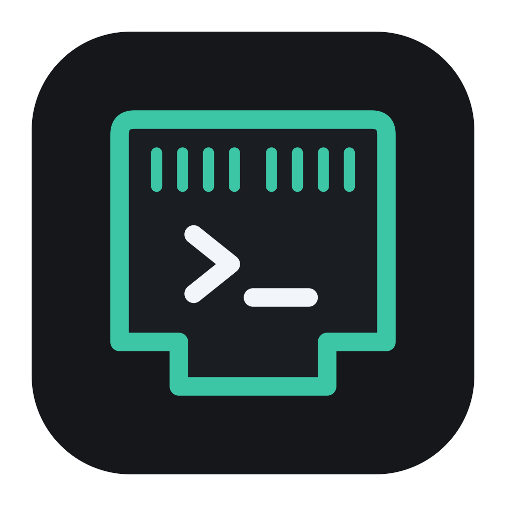
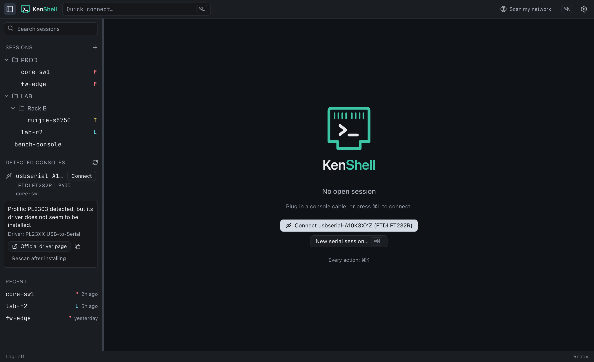

<p align="center">
  
</p>

<h1 align="center">KenShell</h1>

<p align="center">
  <b>The terminal that knows it is talking to a switch.</b><br/>
  SSH, Telnet and serial console in one small, fast desktop app,<br/>
  with a built-in CLI analyzer for Cisco and Ruijie devices.
</p>

<p align="center">
  
  
  
</p>

<p align="center">
  <a href="#download-and-install"><b>Download</b></a> ·
  <a href="docs/USER_GUIDE.md"><b>User Guide</b></a> ·
  <a href="#features"><b>Features</b></a> ·
  <a href="#for-developers"><b>For developers</b></a>
</p>

<p align="center">
  
</p>

KenShell is a lightweight network terminal for network engineers. It combines what you
would normally use PuTTY or SecureCRT for (connecting to devices) with what you would use
a CLI analyzer for (understanding their output). Plug in a console cable and you're on the
device in seconds. Open an SSH session and KenShell tells you which device it is, which CLI
mode you're in, and whether it's production. Run a `show` command and get a sortable table.

## Why KenShell

Most terminal emulators treat a switch like any other Unix host. KenShell knows it is talking
to network gear:

- **Plug-and-connect USB console.** Plug in a console cable and the port shows up in the
  sidebar with its chip (FTDI, Prolific, CP210x, CH340 …). KenShell detects the baud rate
  automatically, and tells you when a driver is missing.
- **You always know where you are.** Every session shows its connection identity (protocol,
  target, device hostname, model, OS version) and a colour stripe for the current CLI mode:
  user, privileged, config, boot or shell. Production sessions are tagged so you don't mistake
  them for lab gear.
- **Built for Cisco and Ruijie first**, and it also recognises Juniper, Alcatel-Lucent
  OmniSwitch, Aruba/HPE, Huawei and FortiGate prompts.
- **Small and fast.** Starts in a quarter of a second and stays under 100 MB of memory.

## Features

**Connections**
- **Protocols:** SSH (password, public key, keyboard-interactive, agent, legacy algorithms
  per session), Telnet, serial, Rlogin and raw TCP.
- **SSH extras:** port forwarding (local, remote, dynamic/SOCKS5), jump host,
  SOCKS5/HTTP proxy, X11 forwarding, keepalive and auto-reconnect.
- **Host keys:** checked against known hosts. A changed host key blocks the connection.
- **Quick connect:** type `ssh admin@10.0.0.1`, `telnet 10.0.0.5 2001` or `COM4`.
- **Session manager:** nested folders, tags, favourites, instant search, recent connections,
  drag-and-drop and bulk edit.
- **Import and export:** import from PuTTY, SecureCRT, MobaXterm and CSV; export to JSON
  or CSV (never with passwords).
- **Credentials:** kept in the OS keychain, with reusable credential profiles, a portable
  encrypted vault backup (Argon2id + ChaCha20-Poly1305), and an SSH key generator
  (Ed25519/RSA, `.ppk` ↔ OpenSSH).

**Terminal**
- **Tabs:** draggable tabs, split view with up to four panes, and detaching a tab into its
  own window.
- **Everyday terminal features:** copy on select, paste with a right-click, regex search in
  scrollback, line timestamps, charsets and backspace mapping.
- **Smart paste:** a per-line delay for serial and Telnet, with an optional preview.
- **Broadcast:** type into several tabs at once; those tabs are clearly marked.
- **Output highlighting:** up/down states, errors, IP/MAC addresses and interface names are
  coloured. Clicking an IP or interface opens actions for it.
- **Automation:** command history with inline autocomplete, and automatic `--More--`
  continuation.
- **Logging and recording:** logging to disk (file-name templates, printable or raw, optional
  timestamps), session recording with a replay player, and export as TXT or coloured HTML.

**Analysis**
- **Structured output:** parsers turn `show` output into sortable tables you can export to
  CSV (Cisco, Ruijie, Juniper).
- **Read-only checks:** a diagnostics run with findings ranked by severity, and config audit
  rules.
- **Config backups:** compressed backups compared in a side-by-side diff.
- **Log analysis:** analyse `show tech`, crashinfo and log files.
- **Topology:** a CDP/LLDP map; connect to a neighbour with one click.
- **Multi-device:** run read-only commands on many devices at once.
- **Network scanner:** ICMP, the ARP table, TCP 22/23/80/443/3389 and reverse DNS, with
  vendor names from the built-in IEEE OUI table.

**Notes and snippets**
- **Device notes:** Markdown, pinnable, searchable, and linked to interfaces
  (`Gi1/0/24: camera`). They are shown as terminal tooltips and in the session list.
- **Notes bar:** opens under each session for quick, time-stamped notes, like a work log.
- **Snippets:** a library with Cisco and Ruijie starter sets, plus templates with variables
  and a fill-in form.

**Tools**
- **File transfer:** an SFTP/SCP client, and built-in TFTP, FTP and SCP servers for
  firmware and config transfers.
- **Network utilities:** subnet calculator, OUI lookup, MAC format converter, ping and
  traceroute.

**App**
- **Interface:** dark, light or system theme, English and Turkish, customisable shortcuts,
  a command palette for every action, and accessible keyboard navigation.
- **Updates:** a small card announces a new version; nothing installs until you click it.
- **Privacy:** no telemetry. Passwords and secrets never reach logs, the database or exports.

## Performance

KenShell is built to stay out of your way, even on an old laptop in a cold server room.

| Measure (macOS arm64 release build) | Result   | Budget  |
| ----------------------------------- | -------- | ------- |
| Cold start (median)                 | 265 ms   | < 1 s   |
| Idle memory                         | 84.3 MB  | < 100 MB |
| Extra memory per open session       | 3.3 MB   | < 15 MB |
| Installer (dmg)                     | 7.05 MB  | < 15 MB |
| JavaScript (gzipped)                | 435.1 KB | < 500 KB |

## Download and install

Get the latest version from the **[Releases](../../releases)** page:

| Platform | Package                                                |
| -------- | ------------------------------------------------------ |
| macOS    | Universal `.dmg` (Apple silicon + Intel)               |
| Windows  | NSIS installer, MSI, and a portable `.zip`             |
| Linux    | AppImage and `.deb`                                    |

On Linux your user needs serial-port access (`dialout` or `uucp` group). KenShell shows the
exact command on first launch if it is missing.

## Documentation

- **[User Guide](docs/USER_GUIDE.md):** every feature step by step, keyboard shortcuts and
  troubleshooting.

## Privacy

- **No telemetry:** KenShell collects no usage data and never reports on you or your devices.
- **Secrets stay put:** saved passwords live in the operating system's keychain. Passwords
  and secrets never reach log files, the database or exports.
- **Updates ask first:** when a new version is out, a small card offers it; nothing is
  installed until you click **Update now**.

---

## For developers

<p>
  
  
  
  
</p>

### Building from source

**Requirements:** Node.js 24, Rust 1.90+ (`rustup`), and the
[Tauri 2 prerequisites](https://v2.tauri.app/start/prerequisites/) for your OS.

```bash
npm ci
npx vite build          # tauri::generate_context! needs dist/ once on a fresh clone
npm run app:dev         # app with hot reload
npm run app:build       # release build + installers
```

The frontend also runs in a plain browser (`npm run dev`, port 1420) with demo data, which is
handy for UI work.

#### Checks

| Task                       | Command                                                      |
| -------------------------- | ------------------------------------------------------------ |
| Frontend typecheck         | `npm run typecheck`                                          |
| Frontend lint / format     | `npm run lint` · `npm run format:check`                      |
| Frontend tests (Vitest)    | `npm test`                                                   |
| Rust check / lint / format | `cargo check --workspace` · `cargo clippy --workspace --all-targets -- -D warnings` · `cargo fmt --all` |
| Rust tests                 | `cargo test --workspace`                                     |
| Bundle-size budget         | `npx vite build && npm run bench:bundle`                     |
| App budget (start/RAM/CPU) | `npm run app:build && npm run bench:app`                     |
| Device simulator           | `npm run sim -- --profile ruijie --port 2323`                |

The **device simulator** (`tools/device-simulator`) emulates Cisco and Ruijie CLIs over
Telnet, SSH, raw TCP or stdio, including `--More--` paging and mode changes. It drives the
end-to-end tests and is useful for trying the app without real hardware.

### Architecture

KenShell is a [Tauri 2](https://v2.tauri.app/) app. The **Rust backend** owns every
connection, file and secret; the **React frontend** renders the UI and talks to the backend
only through typed IPC commands and event channels.

```
┌──────────────── React 19 + TypeScript (Vite, Tailwind 4) ────────────────┐
│  xterm.js terminals · zustand stores · i18n (en/tr) · design tokens      │
│  src/lib/ipc.ts  ← the only place that calls Tauri `invoke`              │
└───────────────▲───────────────────────────────────────┬──────────────────┘
                │ events / channels (batched bytes)     │ commands
┌───────────────┴───────────────────────────────────────▼──────────────────┐
│  Rust (Tauri 2)                                                          │
│  commands/  thin command layer                                           │
│  session/   SessionManager, per-session task, reconnect                  │
│  transport/ SSH (russh), Telnet, serial, Rlogin, raw, forwarding, X11    │
│  device/    prompt/mode observer, identity probe, interface names        │
│  analyzer/  parsers, diagnostics, config rules, backups, diff, topology  │
│  console_detect/  USB enumeration, hot-plug, autobaud, driver hints      │
│  storage/   SQLite (WAL, FTS5), versioned migrations                     │
│  secrets/   OS keychain, encrypted vault · logging/ logs + recordings    │
│  transfer/  SFTP/SCP client, TFTP/FTP/SCP servers · netscan/ scanner     │
│  platform/  all OS-specific code (macOS, Windows, Linux)                 │
└──────────────────────────────────────────────────────────────────────────┘
```

#### Repository layout

| Path                     | What is there                                                       |
| ------------------------ | ------------------------------------------------------------------- |
| `src/app/`               | App shell, actions (command palette + shortcuts), global effects    |
| `src/components/`        | UI components (sidebar, tabs, panes, identity bar, panels, dialogs) |
| `src/terminal/`          | xterm.js integration, highlighting, export, replay player          |
| `src/stores/`            | zustand state (tabs, settings, notes, consoles, servers …)          |
| `src/lib/`               | Pure logic (IPC wrapper, parsers, subnet math, shortcuts …)         |
| `src/data/`              | Vendor mode patterns, highlight rules, snippet starter sets        |
| `src/i18n/`              | `en.json` and `tr.json` (identical keys, enforced by a test)        |
| `src/styles/tokens.css`  | Design tokens: every colour and size used in the UI                 |
| `src-tauri/src/`         | Rust backend (see the diagram above)                                |
| `src-tauri/data/`        | Embedded data, such as the compressed IEEE OUI table               |
| `tools/device-simulator` | Cisco/Ruijie CLI simulator used by tests                            |
| `tools/scripts/`         | Generators (OUI table, icons, updater manifest)                     |
| `bench/`                 | Bundle-size and app start/RAM/CPU measurements                      |
| `docs/`                  | User guide and README assets                                        |

#### Design rules

- **No confirm dialogs.** Feedback is a toast or a status-bar message. The single exception
  is a changed SSH host key, which blocks the connection.
- **Mode colours come from a `data-mode` attribute** and design tokens, never from inline
  colours set by React state. A mode change is one attribute swap.
- **All UI text goes through `src/i18n`.** Both locales must have identical keys.
- **Secrets never reach logs, error messages, the database or exports.**
- **Every new dependency needs an ADR** and is checked against the
  size budget.
- **Rust:** `clippy -D warnings` clean. `unsafe` is used only for required platform APIs,
  each with a justification.

### Continuous integration

`.github/workflows/ci.yml` runs on every push:
- **Lint, typecheck and tests** on macOS and Windows.
- **Budget checks:** bundle size and app start/RAM.
- **Linux serial end-to-end tests** against virtual serial ports.
- **Signed bundles** for all three platforms. Signing switches on only when the
  certificates are configured as repository secrets.
- **Releases:** a `v*` tag creates a draft GitHub release with the updater manifest.

## License

Copyright © 2026 omereniskorkusuz. All rights reserved. This repository is private; no licence
is granted to use, copy or distribute the code.
